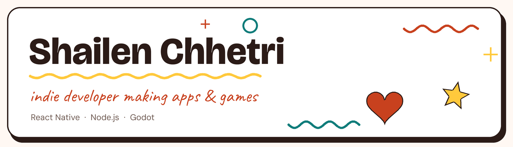

**Solo software engineer** building mobile apps and games, published under the name [S-Indie LabS](https://sindielabs.dev).
Based in Nepal 🇳🇵

## 🚀 What I'm building

### 💘 [Couplay](https://couplay.sindielabs.dev): a dating app you play first
Game-based dating: you play short games, and matches are made on **values, never skill**.
- Swipe deck with match % and "why you click" reasons
- Solo games that feed matching (This-or-That, Red Flag / Green Flag, Rank It)
- Pair games with a match (Guess-My-Answer, Two Truths and a Lie, Build-a-Date, Doodle Guess)
- Passwordless sign-in, verified-selfie badge, English / Nepali / Hindi
- **Stack:** Expo, React Native, TypeScript, Supabase

### ⚔️ [Focus Delve](https://focusdelve.sindielabs.dev): finish real work, clear a dungeon
A focus timer where your hero delves while you work. Finish the run to defeat the guardian and earn XP and gold.
- Pay once, fully offline: no ads, subscriptions, accounts or backend
- Daily quests, statistics and a camp shop
- **Stack:** Godot 4, GDScript, Android first

## 🎮 Games

| Game | What it is | Tech |
| :-- | :-- | :-- |
| ⚡ **[CyberFlap](https://play.google.com/store/apps/details?id=com.cyberflap.arcade)** | Neon cyberpunk arcade runner: fly an anti-gravity craft through laser barriers and drones, with global leaderboards | React, TypeScript, Capacitor, Firebase |
| 🌀 **[Gravity Shift: Cyber Protocol](https://sindielabs.dev/#gravityshift)** | Precision gravity-inversion puzzle platformer where fair, deterministic challenge beats reflex | Godot 4, GDScript |
| 🏢 **Shift Floor** | 2.5D survival party game | Godot 4 |
| 🌑 **Dormant Line** · ⏳ **Six Hours Ahead** | 3D games, currently in development | Godot |

## 🛠️ Tech stack

### 📬 Let's talk
Building something, or want to work together? **[hello@sindielabs.dev](mailto:hello@sindielabs.dev)**

